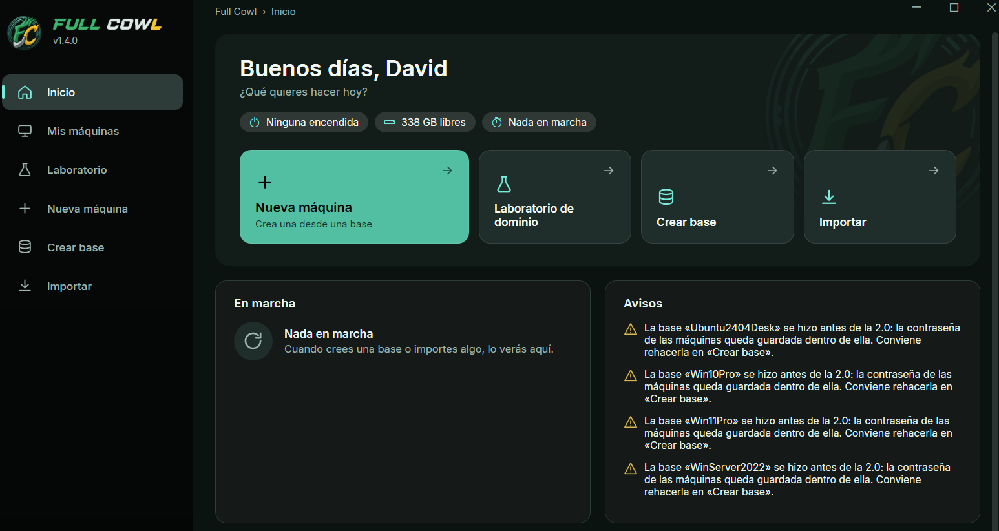

<p align="center"></p>

<p align="center">
  <a href="README.md">Español</a> · <b>English</b><br>
  
  
  
  
  <a href="https://github.com/MrDavid99-hub/FullCowl/actions/workflows/comprobar.yml"></a>
</p>

# Full Cowl

**Automates building virtual machines and labs in VMware Workstation.** You create a base once per operating system
(no clicking through installers) and then get complete machines and labs from it in seconds, with network, users,
domain and software ready. Made for IT classes and for anyone practising system administration.

> **Note:** the application and its [manual](docs/MANUAL.md) are **in Spanish only** for now.

<!-- galeria -->
<p align="center"><picture>
  <source media="(prefers-color-scheme: light)" srcset="docs/img/inicio-claro.png">
  
</picture></p>
<!-- /galeria -->

## What it does

- **Unattended bases** (once per system): Windows Server 2025/2022/2019, Windows 10/11, Ubuntu 26.04/24.04/22.04
  (server or desktop), Lubuntu, Debian 13/12, Rocky and AlmaLinux 9, Arch Linux and Kali. **Packer** builds them from
  your ISO, in the **language, keyboard layout and time zone** you choose (Spanish or English). Parrot, Proxmox,
  pfSense, OPNsense and FreeBSD come with a step-by-step **manual install guide**.
- **Machines in seconds**: linked or full clones that configure themselves on first boot (computer name, static IP,
  time zone, Windows roles, **create or join a domain**, Linux packages).
- **Whole labs at once**: several machines on the same network with consecutive IPs and a ready domain; a **network
  map**, a starting state to go back to, a **lab sheet** for your report, and **disposable** machines. Labs can be
  shared as `.fclab` files (examples in `laboratorios/`).
- **Manage**: start/stop many at once, snapshots, networking, **bulk users**, connect by Remote Desktop or SSH, copy
  files, **import/export**, and **disk space clean-up**.
- **Interface** with light/dark/automatic theme, a plain mode for class, and accent colours. It **updates itself**.

## Install

Paste this line into **PowerShell**, **CMD** or **Terminal**:

```
powershell -NoProfile -ExecutionPolicy Bypass -Command "irm https://raw.githubusercontent.com/MrDavid99-hub/FullCowl/main/instalar.ps1 | iex"
```

It downloads the latest release, **checks that it has not been damaged or changed** (SHA-256) and installs Full Cowl
in `%USERPROFILE%\Full Cowl`: it copies the program, downloads **Packer** from HashiCorp's official site and creates
shortcuts. **It does not ask for administrator rights** and changes nothing outside that folder (apart from the
shortcuts). At the end it opens Full Cowl, whose setup wizard asks for your ISO and machine folders, user and password.

**Want to check it first?** This kind of command runs what is in the repository, so you are trusting its author. To
read it first: download [`instalar.ps1`](instalar.ps1), open it in Notepad and, if you are happy, run it with right
click → *Run with PowerShell*.

**Or download the ZIP:** from [*Releases*](https://github.com/MrDavid99-hub/FullCowl/releases/latest) get `Full-Cowl.zip`,
unzip it anywhere and double-click **`Instalar Full Cowl.bat`** (if SmartScreen warns you: *More info* → *Run anyway*).

### Requirements

- **Windows 10 or 11**, 64-bit.
- **[VMware Workstation Pro](https://www.vmware.com/products/desktop-hypervisor/workstation-and-fusion)** (not
  installed for you: it needs a Broadcom account).
- **Your own ISO files** for the systems you want (none are included) and an Internet connection to build bases.
- Recommended: 16 GB of RAM and free disk space (a Windows base takes 10-20 GB).

### Update and uninstall

- **Update:** Full Cowl tells you when there is a new version (*Actualizar ahora* button), or run **`Actualizar.bat`**.
  Your settings and machines are not touched.
- **Uninstall:** **`Desinstalar Full Cowl.bat`** in its folder. It never deletes your machines, bases or ISO files.

## Privacy and security

- The machines' password is stored **encrypted (DPAPI) only on your PC**; it is never uploaded or written to settings
  files. Bases are installed with a one-time password and each machine gets yours on first boot.
- Full Cowl sends no data to anyone.
- Windows is installed with the **generic setup keys** published by Microsoft (they install, they do not activate):
  **your Windows licences are your own**.
- Found a bug? Open an issue using the template (no passwords). A security problem? See [SECURITY.md](SECURITY.md).
- Pull requests are **not accepted** for now: issues are read here and fixes ship in the next version.

## Licence and trademarks

Code under the **MIT** licence ([LICENSE](LICENSE)). Windows, Ubuntu, Kali, Debian, Rocky, Arch, Proxmox, pfSense and
VMware are trademarks of their respective owners. Their logos are only used to identify each system; Full Cowl is
independent and not endorsed by them. More details and third-party software in [NOTICE.md](NOTICE.md) (in Spanish).

*Full Cowl · David Cabello Grimaldi*
