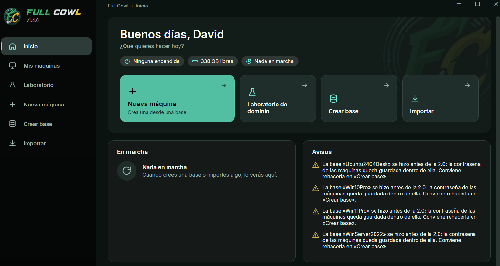
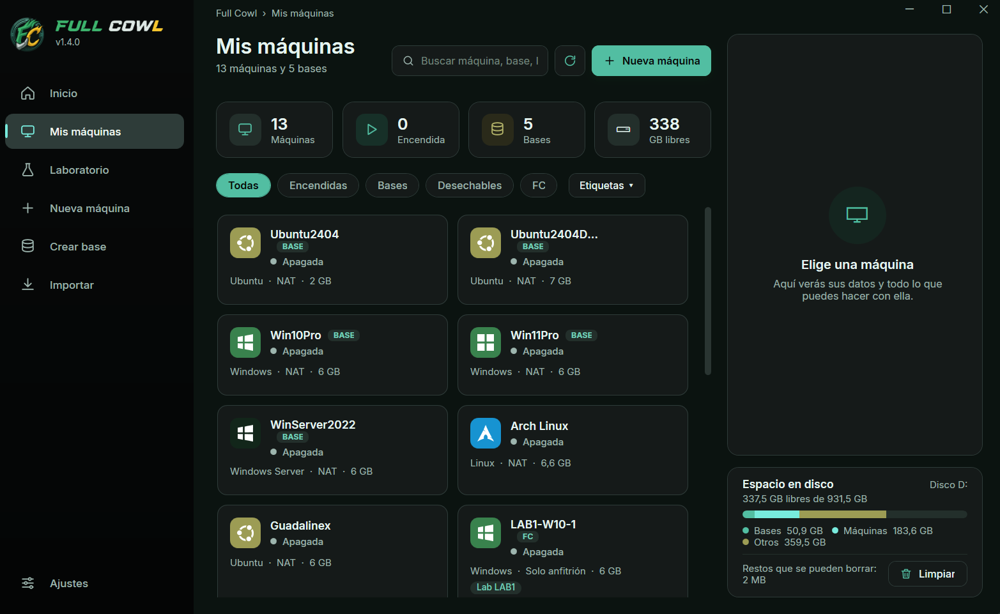
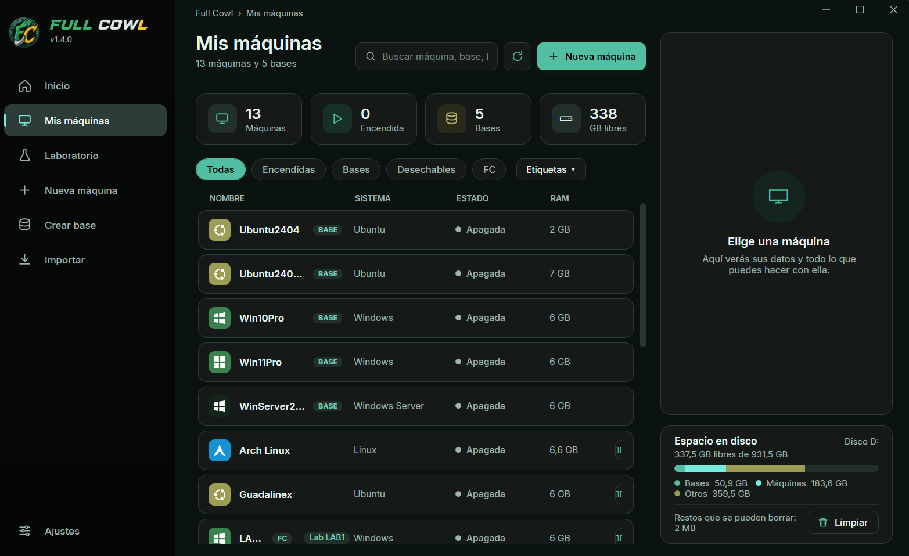
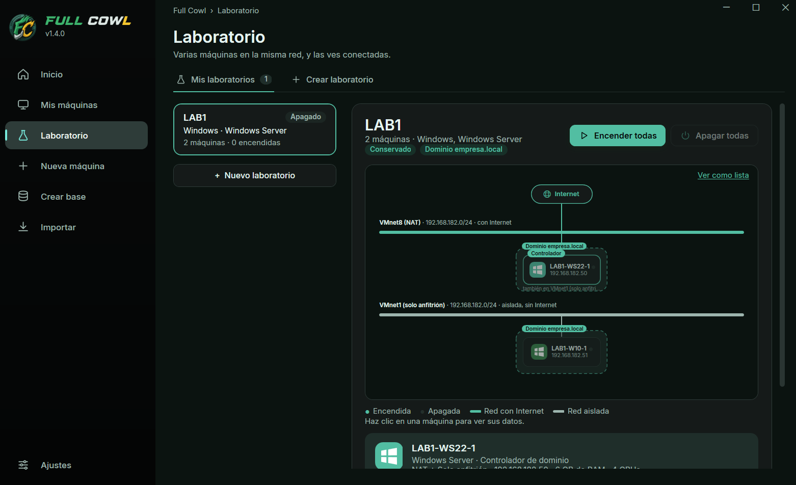
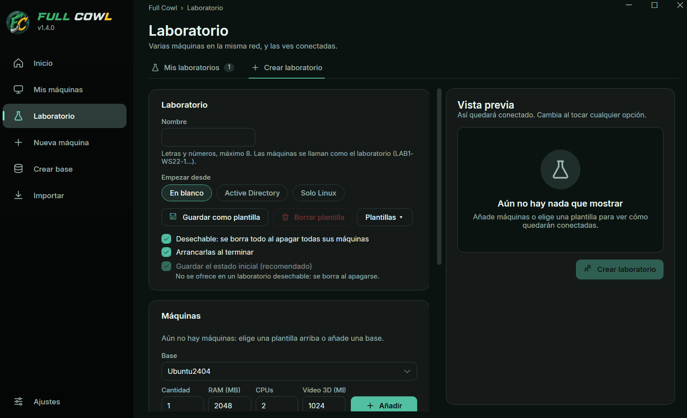
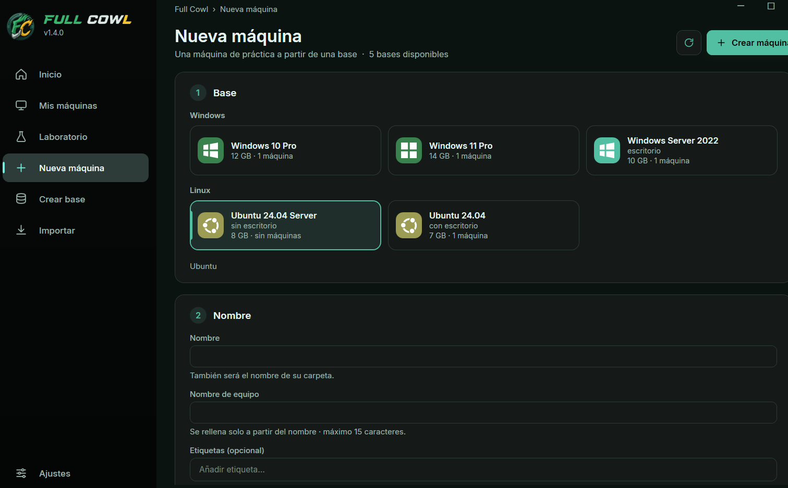
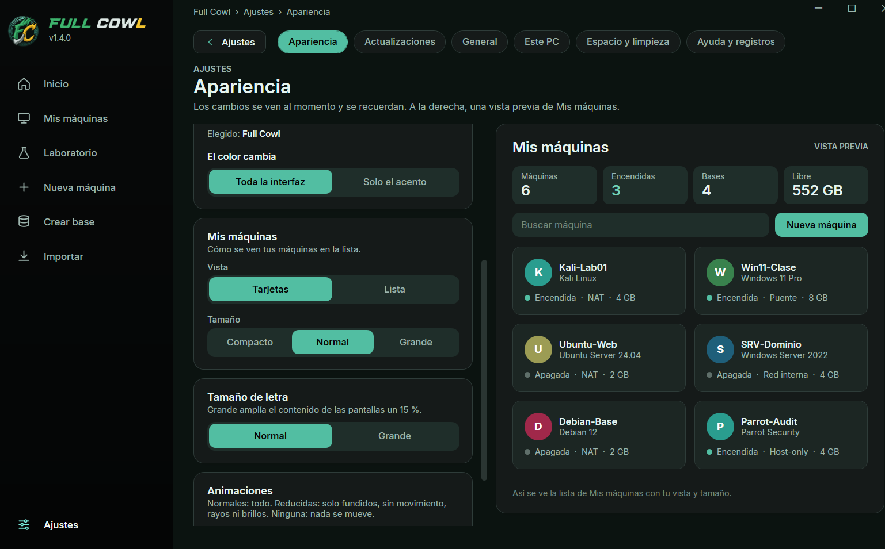

<p align="center"></p>

<p align="center">
  <b>Español</b> · <a href="README.en.md">English</a><br>
  
  
  
  
  <a href="https://github.com/MrDavid99-hub/FullCowl/actions/workflows/comprobar.yml"></a>
</p>

# Full Cowl

**Automatiza la creación de máquinas y laboratorios en VMware Workstation.** Crea una base una vez por sistema
(sin tocar el instalador) y saca de ella, en segundos, máquinas y laboratorios completos: con red, usuarios,
dominio y programas listos. Pensado para clase (ASIR/SMR) y para quien practica administración de sistemas.

<!-- galeria -->
<p align="center"><picture>
  <source media="(prefers-color-scheme: light)" srcset="docs/img/inicio-claro.png">
  
</picture></p>

<table>
<tr><td><br>Mis máquinas: tarjetas, con el panel de la máquina elegida.</td>
<td><br>Mis máquinas en lista, para muchas a la vez.</td></tr>
<tr><td><br>Laboratorio: el mapa de red con las máquinas conectadas.</td>
<td><br>Crear laboratorio: ves cómo quedará antes de crearlo.</td></tr>
<tr><td><br>Nueva máquina: eliges la base y lo que lleva.</td>
<td><br>Apariencia: tema claro, oscuro, sobrio y colores.</td></tr>
</table>
<!-- /galeria -->

## Qué hace

- **Bases desatendidas** (una vez por sistema): Windows Server 2025/2022/2019, Windows 10/11, Ubuntu 26.04/24.04/22.04
  (servidor o escritorio), Lubuntu, Debian 13/12, Rocky y AlmaLinux 9, Arch Linux y Kali. Las crea **Packer** desde
  tu ISO, en el **idioma, teclado y zona horaria** que elijas. Parrot, Proxmox, pfSense, OPNsense y FreeBSD tienen una
  **guía de instalación manual** paso a paso.
- **Máquinas en segundos**: clon enlazado o completo; al arrancar se configuran solas (nombre, IP fija, zona horaria,
  roles de Windows, **crear un dominio o unirse a uno**, programas en Linux).
- **Laboratorios de una vez**: varias máquinas en la misma red, con IP seguidas y dominio montado; **mapa de red**,
  estado inicial al que volver, **ficha del laboratorio** para la memoria y máquinas **desechables**. Se pueden
  compartir como archivo `.fclab` (hay ejemplos en `laboratorios/`).
- **Gestionar**: encender/apagar varias, instantáneas, red, **usuarios en masa**, conectar por Escritorio remoto o
  SSH, pasar archivos, **importar/exportar** y **espacio y limpieza**.
- **Interfaz** con tema claro/oscuro/automático, modo sobrio para clase y colores. Se **actualiza sola** desde dentro.

La interfaz y el [manual](docs/MANUAL.md) están **en español**.

## Instalación

Pega esta línea en **PowerShell**, **CMD** o **Terminal**:

```
powershell -NoProfile -ExecutionPolicy Bypass -Command "irm https://raw.githubusercontent.com/MrDavid99-hub/FullCowl/main/instalar.ps1 | iex"
```

Descarga la última versión, **comprueba que no está dañada ni cambiada** (SHA-256) e instala Full Cowl en
`%USERPROFILE%\Full Cowl`: copia el programa, descarga **Packer** de la web oficial de HashiCorp y crea los accesos
directos. **No pide permisos de administrador** y no cambia nada fuera de esa carpeta (salvo los accesos directos).
Al terminar abre Full Cowl, y su asistente te pide las carpetas de ISO y de máquinas, el usuario y la contraseña.

**¿Prefieres revisarlo antes?** Este tipo de comando ejecuta lo que hay en el repositorio, así que confías en su autor.
Si quieres verlo primero: descarga [`instalar.ps1`](instalar.ps1), ábrelo con el Bloc de notas y, si te parece bien,
ejecútalo con clic derecho → *Ejecutar con PowerShell*.

**O descarga el ZIP:** en [*Releases*](https://github.com/MrDavid99-hub/FullCowl/releases/latest) baja `Full-Cowl.zip`,
descomprímelo donde quieras y haz doble clic en **`Instalar Full Cowl.bat`** (si Windows avisa con SmartScreen:
*Más información* → *Ejecutar de todas formas*).

### Requisitos

- **Windows 10 u 11** de 64 bits.
- **[VMware Workstation Pro](https://www.vmware.com/products/desktop-hypervisor/workstation-and-fusion)** (no se
  instala solo: se descarga con una cuenta de Broadcom).
- **Tus propias ISO** de los sistemas que quieras usar (no se incluyen) y conexión a Internet para crear bases.
- Recomendado: 16 GB de RAM y espacio en disco (una base de Windows ocupa 10-20 GB).

### Actualizar y desinstalar

- **Actualizar:** Full Cowl avisa cuando hay una versión nueva (botón *Actualizar ahora*), o usa **`Actualizar.bat`**.
  Tus ajustes y tus máquinas no se tocan.
- **Desinstalar:** **`Desinstalar Full Cowl.bat`** en su carpeta. Nunca borra tus máquinas, bases ni ISO.

## Privacidad y seguridad

- La contraseña de las máquinas se guarda **cifrada (DPAPI) solo en tu PC**; nunca se sube ni se escribe en archivos
  de configuración. Las bases se instalan con una contraseña de un solo uso y cada máquina recibe la tuya al arrancar.
- Full Cowl no envía datos a nadie.
- Para instalar Windows se usan las **claves genéricas** que publica Microsoft (instalan, no activan): **las licencias
  de Windows son tuyas**.
- ¿Un fallo? Abre una *issue* con la plantilla (sin contraseñas). ¿Un problema de seguridad? Mira [SECURITY.md](SECURITY.md).
- De momento **no se aceptan *pull requests***: los avisos se leen aquí y los arreglos salen en la versión siguiente.

## Estructura

```
Abrir Full Cowl.bat · Instalar Full Cowl.bat · Actualizar.bat · Desinstalar Full Cowl.bat
instalar.ps1           lo que ejecuta el comando de instalación
docs/MANUAL.md         manual técnico y de usuario
laboratorios/          laboratorios de ejemplo (.fclab)
full-cowl/             el programa
  interfaz/            pantallas (.xaml) y su lógica
  clon/                lo que se ejecuta dentro de las máquinas
  packer/              plantillas de Packer e instalación desatendida
  instalacion/         instalador, Packer, desinstalador
  recursos/            logos, fuentes, versiones
herramientas/          para quien desarrolla (comprobaciones, Release)
```

## Licencia y marcas

Código bajo licencia **MIT** ([LICENSE](LICENSE)). Windows, Ubuntu, Kali, Debian, Rocky, Arch, Proxmox, pfSense y
VMware son marcas de sus propietarios. Sus logos solo sirven para reconocer cada sistema; Full Cowl es independiente
y no está respaldado por ellos. Más detalles y software de terceros en [NOTICE.md](NOTICE.md).

*Full Cowl · David Cabello Grimaldi*
